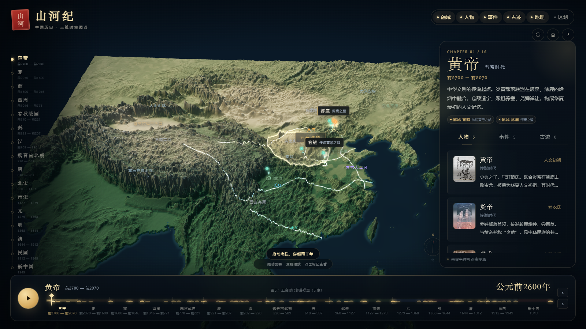

# 山河纪 · 中国历史三维时空图谱

一个可直接在浏览器中演示的 **3D 中国历史课件**：从黄帝与五帝时代一路走到 1949 年新中国成立，以真实东亚高程为地形，随时间轴切换疆域，并把人物、事件、古迹与行政区划标注在三维山河之上。



## 快速开始

需要 **Chrome / Edge 等支持 WebGL 的现代浏览器**，以及 **Python 3.8+**。

```bash
python serve.py
```

脚本会自动打开浏览器，并输出地址（默认 <http://127.0.0.1:8000>）。如果端口被占用，会自动尝试后续端口。

Windows 用户也可以直接双击 **`start.bat`**。

> 不要直接双击 `index.html`。浏览器会以 `file://` 方式拦截贴图与 `geo.json` 的读取，页面会给出启动服务的提示。

## 交互方式

| 操作 | 说明 |
| --- | --- |
| 左键拖动 | 旋转视角 |
| 滚轮 / 双指捏合 | 缩放 |
| 右键拖动 / 双指拖动 | 平移 |
| 拖动底部时间轴 | 穿越时间；跨过章节时自动切换疆域 |
| ▶ / 空格 | 播放或暂停历史长卷 |
| 点击时间轴上的小圆点 | 直接跳到该事件 |
| 点击人物 / 事件 / 古迹标记 | 查看详情并飞抵现场 |
| 点击卡片图片 / 「百科」 | 打开本地图片图集与离线百科 |
| 图片右上角全屏按钮 | 全屏查看图片；多图可左右切换 |
| 右侧面板 | 人物、事件、古迹分类列表；点击条目定位 |
| 顶部图层 | 开/关疆域、人物、事件、古迹、地理、区划 |
| 顶部按钮 | 自动环绕、重置视角、使用说明 |
| ← / → | 微调时间（Shift 加速） |
| Esc | 关闭详情 / 百科 / 说明 / 移动端侧栏 |

移动端会自动收起右侧面板，点击右上角「章」展开，面板内有「×」收起。

## 内容规模

- **16 个历史时期**：黄帝（五帝时代）、夏、商、西周、春秋战国、秦、汉、魏晋南北朝、唐、北宋、南宋、元、明、清、民国、新中国
- **85 位历史人物**、**97 个事件**
- **22 处古迹**：长城、兵马俑、都江堰、大雁塔、布达拉宫、故宫、莫高窟、大运河、赵州桥、乐山大佛等
- **4 条水系**：黄河、长江、珠江、京杭大运河
- **12 个地理标注**：青藏高原、塔克拉玛干沙漠、黄土高原、喜马拉雅山脉、秦岭等
- **行政区划标注**：秦郡、汉州、唐道、宋路、元行省、明清布政使司/省等，按历史行政中心示意
- 每章都有时代概述、都城信息与疆域图注

## 本地图片与离线百科

- 每处古迹、人物、事件、都城都有本地百科条目，包含时代背景、人物与时代、建筑与艺术、相关条目等分节。
- 右侧卡片与详情卡显示真实图片缩略图；古迹优先保存 **多张** 图片，打开「百科」时可切换图集。
- 点击「百科」打开的是完全本地的图集与百科，不跳转任何外部站点；断网也能阅读文字与图片。
- 图片右上角有全屏按钮，可全屏查看；多图古迹支持左右切换与键盘方向键。
- 图片通过搜狗图片 / Bing 等公开图片检索获取，按标题相关性筛选，已下载为本地 WebP；古迹优先 3 张，人物、事件、都城各 1 张；没有合适图片的条目使用类型占位图。
- 图片版权归原作者；课件中的图片仅用于课堂教学展示，公开分发时请替换为已获授权的版本。每条图片的来源与许可提示显示在图集下方。

## 区划图层

顶部「区划」图层会按各时期的行政中心标注：

- 秦：内史、陇西、上郡、南郡、南海等郡
- 汉：司隶、豫州、冀州、益州、交州等州
- 唐：关内、河南、河东、剑南、岭南等道
- 宋：京畿、河北、两浙、福建、广南等路
- 元：中书省、辽阳、河南江北、江浙、湖广等行省
- 明清：布政使司 / 省
- 民国、新中国：省与自治区

区划为**教学示意标注**，没有绘制精确的历史边界；早期传说时代暂无省制，点击图层会给出提示。

## 边界与年代说明

- 时间轴按章节等宽展示，便于课堂浏览；新中国作为 1949 年的尾声章节。
- 人物为该时期的代表人物，不严格按生卒年隐现；事件会随时间轴推进出现；**古迹按建成年代出现**。
- 疆域数据经过简化和局部修补，**属于课堂教学示意，不作为历史地理考证依据**。黄帝、夏、商、西周、春秋战国、秦、南宋等部分轮廓为补形；隋、五代十国等过渡阶段未单独展开。
- 民国疆域采用约 1945 年的简化轮廓；新中国采用现代中国轮廓。

## 技术结构

```text
index.html                 页面与 UI 结构
css/style.css              视觉样式、响应式布局
js/app.js                  Three.js 场景、相机、疆域、标记、时间轴、面板、本地百科
vendor/three.min.js        Three.js r128（本地，无需联网）
assets/
  geo.json                 疆域、人物、事件、古迹、河流、地理标注、区划
  terrain_color.png        地形色彩纹理
  terrain_height.png       高程纹理
  terrain_normal.png       法线纹理
  land_mask.png            海陆掩膜
  wiki.json                本地百科条目、分节、图片索引
  images/                  本地百科图片（WebP）与 manifest
serve.py                   Python 本地静态服务
start.bat                  Windows 一键启动
tools/
  content.py               课件文字内容、疆域配置、区划数据
  build_assets.py          地形纹理与 geo.json 生成
  build_wiki.py            本地百科条目生成
  fetch_images.py          本地百科配图下载与 WebP 化
  fetch_people_bing.py     人物肖像补充（严格标题匹配）
  fetch_dem.py             真实高程瓦片下载与采样
data/
  ne_50m_land.geojson      Natural Earth 海岸线
  world_*.geojson          Historical Basemaps 历史疆域原始数据
  dem_east_asia.npz        已采样好的东亚高程（米）
preview/                   预览图
```

### 重建素材

```bash
pip install numpy pillow
python tools/build_assets.py
```

`data/dem_east_asia.npz` 已随课件提供，正常情况下**不需要联网**。如果希望重新下载真实高程瓦片：

```bash
python tools/fetch_dem.py
python tools/build_assets.py
```

高程采用 Mapzen Terrarium 公开瓦片（SRTM / GMTED），色彩、法线和烘焙光影由 Python 程序化生成。

本地百科图片随课件提供。若需重新抓取配图，可运行 `python tools/fetch_images.py`，再运行 `python tools/build_wiki.py` 合并到 `assets/wiki.json`。图片源为公开网络检索结果，请遵守原网站版权要求。

## 数据与版权

- **历史疆域轮廓**：Historical Basemaps（CC BY-SA 4.0），经 Douglas–Peucker 简化、局部修补与裁切。再分发时请保留署名并以相同方式共享。
- **海岸线**：Natural Earth 1:50m Land（公有领域）。
- **高程**：Mapzen Terrain Tiles / SRTM / GMTED（CC BY 4.0）。
- **文字**：为本课件教学演示编写，年代、坐标与描述为近似值；地图中的疆域、事件位置、区划标注均为示意。
- **图片**：通过搜狗图片 / Bing 等公开图片检索获取并本地保存；版权归原作者，仅用于课堂教学展示，公开分发请替换为授权版本。

课件代码可自由修改用于教学；第三方数据请遵循上述许可。

## 浏览器与性能

- 推荐 1600×900 及以上、开启硬件加速的 Chrome / Edge。
- 地形网格约 11 万顶点，纹理 1440×1120；普通集成显卡可流畅运行。
- 首次加载需要读取约 5 MB 地形纹理、117 KB 地理数据、382 KB 本地百科与约 9 MB 本地图集（按需加载）。
- 课件主体、本地百科文字与本地图片完全离线可用；不依赖外部百科站点。
